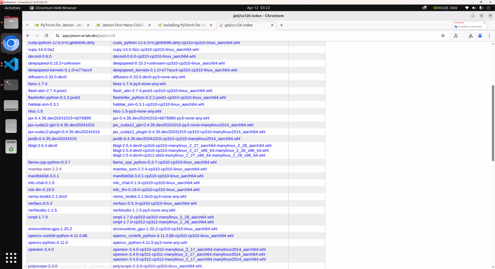
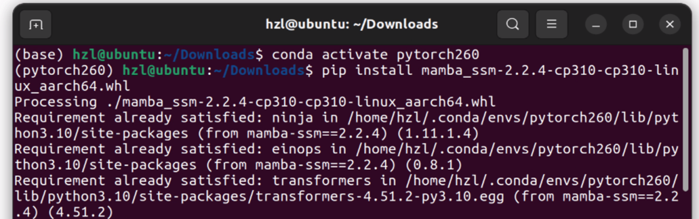
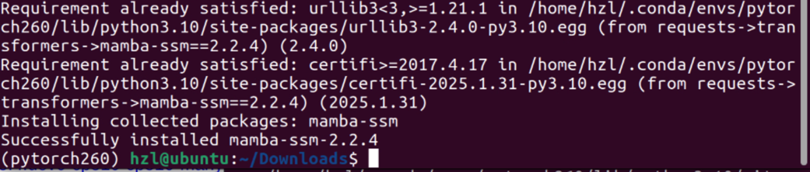

<div align="center">
  
</div>

# CrackMamba

Official PyTorch implementation of **CrackMamba: An attention-guided Mamba architecture for efficient and edge-ready crack segmentation using global and local information**.

**[Zhili He](http://zl-he.com/), Wai Yi Chau, [Mei Ling Leung](https://www.linkedin.com/in/mei-ling-leung2389/), Yingyue Han, [Wessam Hamid](https://wessam.carrd.co/), [Yu-Hsing Wang](https://seng.hkust.edu.hk/about/people/faculty/yu-hsing-wang), and [Jian Zhang](https://civil.seu.edu.cn/zj/list.htm)**<br>
*Expert Systems with Applications*, Volume 329, Article 133035, 2026.

### 🍓 Paper:

[Journal paper](https://www.sciencedirect.com/science/article/abs/pii/S0957417426019469?via%3Dihub) · [arXiv preprint](https://arxiv.org/abs/2407.15714) · [Steelcrack dataset](https://github.com/hzlbbfrog/Civil-dataset#-steelcrack)

### 🧭 Contents

- **Project:** [Introduction](#-introduction) · [Repository structure](#repository-structure) · [Updates](#-updates)
- **Reproduction:** [Requirements](#1-requirements) · [Installation](#2-installation-of-mamba) · [Dataset](#3-prepare-the-dataset) · [Training](#4-training-and-validation) · [Evaluation](#5-test)
- **Resources:** [Jetson deployment](#-deploy-crackmamba-on-jetson-with-tensorrt) · [Citation](#-cite-crackmamba) · [License and contact](#-license-and-contact)

## 📢 Introduction

CrackMamba combines selective state-space modeling with attention-guided feature modulation for pixel-level crack segmentation. Global scan modules capture long-range crack structure, while local scan modules operate on regular and shifted patch grids. The segmentation network fuses features across resolutions and includes an auxiliary output for training.

This release provides the CrackMamba network, its global and local modules, and the Steelcrack training and evaluation entry points. The instructions below follow our three-GPU training configuration.

Benchmark results, ablation studies, and edge deployment experiments are reported in the [journal paper](https://doi.org/10.1016/j.eswa.2026.133035).

<a name="repository-structure"></a>

### 🗂️ Repository structure

| Component | Implementation |
| --- | --- |
| Segmentation network and inference variant | [CrackSeU_B_LN_VT_CrackMamba.py](Nets/CrackSeU_B_LN_VT_CrackMamba.py) |
| Global selective scan module | [CrackMamba_G.py](Nets/Module/CrackMamba_G.py) |
| Local selective scan module | [CrackMamba_L.py](Nets/Module/CrackMamba_L.py) |
| Dataset loaders | [Dataset.py](Dataset.py) |
| Distributed training and validation | [Training script](CrackSeU_main_pal_4_Steelcrack.py) |
| Checkpoint evaluation and prediction export | [Evaluation script](CrackSeU_main_pal_test_4_Steelcrack.py) |
| Deepcrack G-only inference and Jetson deployment | [Jetson deployment guide](deploy/jetson/README.md) |

<details>
<summary>View the full repository layout</summary>

```text
CrackMamba/
├── Nets/
│   ├── CrackSeU_B_LN_VT_CrackMamba.py
│   └── Module/
│       ├── CrackMamba_G.py
│       └── CrackMamba_L.py
├── utils/
│   ├── loss.py
│   └── metrics.py
├── Dataset.py
├── deploy/jetson/
├── CrackSeU_main_pal_4_Steelcrack.py
├── CrackSeU_main_pal_test_4_Steelcrack.py
├── mamba-1.2.0/
├── figures/
├── requirements.txt
├── LICENSE
└── README.md
```

</details>

## 📌 Updates

- **`2026/10/12`**: We release all the code.
- **`2026/05/26`**: Our paper is finally accepted by [Expert Systems with Applications](https://www.sciencedirect.com/science/article/abs/pii/S0957417426019469?via%3Dihub) **(IF 9.4, CCF-C)** after **2 years** later!
- **`2024/07/23`**: The preprint of our paper is publicly available on arXiv. Link → [Arxiv Paper](https://arxiv.org/abs/2407.15714).
- **`2024/07/22`**: The preprint of our paper is submitted to arXiv.
- **`2024/06/30`**: This repository is built up! The code will be gradually released.

## 🏎️ Getting Started

### 1. Requirements

The reference environment from the original implementation is:

| Component | Version |
| --- | --- |
| Operating system | Ubuntu 18.04 |
| Python | 3.8.15 |
| PyTorch | 1.12.1 |
| torchvision | 0.13.1, matching PyTorch 1.12.1 |
| CUDA toolkit | 11.6.2 |
| cuDNN | 8.6.0 |
| Mamba | 1.2.0; the original installation notes also list 1.1.1 |
| causal-conv1d | 1.1.1 |

Use Linux with NVIDIA GPUs for the training and evaluation commands below. The original installation was verified on Ubuntu; native Windows installation was not successful in that setup. [requirements.txt](requirements.txt) supplies compatibility constraints for the reference Python/PyTorch environment rather than a full lockfile of the original experiments.

### 2. Installation of Mamba

#### 2.1 Create the environment

Clone the repository and create an environment:

```bash
git clone https://github.com/hzlbbfrog/CrackMamba.git
cd CrackMamba
conda create -n crackmamba python=3.8.15 -y
conda activate crackmamba
```

#### 2.2 Install PyTorch and dependencies

Install CUDA-enabled PyTorch before building the Mamba extensions. For the reference CUDA 11.6 configuration:

```bash
python -m pip install "numpy<2"
python -m pip install torch==1.12.1+cu116 torchvision==0.13.1+cu116 \
  --extra-index-url https://download.pytorch.org/whl/cu116
python -m pip install -r requirements.txt
```

The PyTorch command follows the [official previous-version installation guide](https://pytorch.org/get-started/previous-versions/#v1121). A CUDA toolkit with `nvcc` is needed when compiling extensions locally; installing a PyTorch CUDA wheel alone does not supply the compiler.

#### 2.3 Install causal-conv1d 1.1.1

```bash
python -m pip install causal-conv1d==1.1.1 --no-build-isolation
```

<details>
<summary>Original causal-conv1d installation screenshot</summary>


</details>

#### 2.4 Install the bundled Mamba 1.2.0 source

The repository retains the original [Mamba 1.2.0 source](mamba-1.2.0) used in the installation tutorial.

```bash
cd mamba-1.2.0
python setup.py install
cd ..
```

<details>
<summary>Original Mamba installation screenshot</summary>


</details>

#### 2.5 Check the environment

```bash
python -c "import torch, mamba_ssm; from mamba_ssm.ops.selective_scan_interface import selective_scan_fn; print('PyTorch:', torch.__version__); print('Mamba:', mamba_ssm.__version__); print('CUDA available:', torch.cuda.is_available()); print('Visible GPUs:', torch.cuda.device_count())"
```

For training, CUDA must be available and three GPUs must be visible. Importing the selective scan function checks extension loading; it does not replace a GPU forward/backward check.

### 3. Prepare the dataset

Download **Steelcrack** from [Civil-dataset](https://github.com/hzlbbfrog/Civil-dataset#-steelcrack), which provides the download links and dataset documentation. Its documented split contains 3,300 training images, 525 validation images, and 530 test images at **512 × 512** resolution.

Arrange the files under the repository root:

```text
CrackMamba/
├── Dataset/
│   └── Steelcrack/
│       ├── Train/
│       │   ├── images/
│       │   ├── masks/
│       │   └── edges/
│       ├── Validation/
│       │   ├── images/
│       │   ├── masks/
│       │   └── edges/
│       └── Test/
│           ├── images/
│           ├── masks/
│           └── edges/
├── Nets/
├── utils/
└── Dataset.py
```

- Use `.png` files with matching image, mask, and edge sample names. Each split must contain the same sample set in all three folders.
- Images are loaded as RGB. Masks and edges are loaded as grayscale; encode background as 0 and foreground as 255.
- The current loader reads edge masks in every split, so keep the `edges/` folders populated for validation and testing as well.
- Run commands from the repository root, because the entry points resolve data paths from the working directory.
- For custom data, prepare image/mask pairs at matching resolutions with height and width divisible by 32. The released entry points below are documented for Steelcrack; the DeepCrack loader requires a corresponding adaptation of the training/evaluation sample contract.

Dataset images, checkpoints, and generated outputs are excluded from Git tracking.

### 4. Training and validation

Run commands from the repository root after completing the environment and dataset setup above.

Make exactly three GPUs visible. On a machine with more GPUs, select the devices before launching:

```bash
export CUDA_VISIBLE_DEVICES=0,1,2
```

Run our training command:

```bash
python -m torch.distributed.launch --nproc_per_node=3 --master_port=25000 CrackSeU_main_pal_4_Steelcrack.py --model=CrackSeU_B_LN_VT_CrackMamba --times=1 --batch_size=9 --learning_rates=6e-3
```

#### Training configuration

This command uses the original PyTorch distributed launcher and the following configuration:

| Setting | Value |
| --- | --- |
| Dataset | Steelcrack, the script default |
| Model | `CrackSeU_B_LN_VT_CrackMamba` |
| GPU processes | 3 on one node |
| Total batch size | 9, with 3 samples per GPU |
| Optimizer | Adam |
| Learning rate | 0.006 |
| Epochs | 70, the script default |
| Run identifier | `1` |
| Main supervision | Binary cross-entropy + soft Dice loss |
| Auxiliary supervision | Binary cross-entropy, weighted by 0.1 |
| Checkpoint selection | Mean validation soft Dice |

Validation begins when the epoch reaches 70% of the configured training duration. A checkpoint is written whenever the validation Dice improves. The supplied command explicitly selects the released architecture; use that model argument when launching training.

#### Checkpoints and logs

For this configuration, outputs are organized as follows:

```text
Checkpoints/
└── SteelcrackCrackSeU_B_LN_VT_CrackMamba/
    └── 1/
        └── CrackSeU_B_LN_VT_CrackMamba_9_Steelcrack_<epoch>.pth

Result_log/
└── log/CrackSeU_B_LN_VT_CrackMamba/9/Steelcrack/70/log.log
```

The epoch in the checkpoint filename is the saved epoch, not necessarily the final training epoch. Checkpoints contain model weights for evaluation; the entry point does not implement optimizer-state resume.

### 5. Test

Evaluate a checkpoint from the same run. Set `TEST_EPOCH` to an epoch for which a checkpoint exists; `67` below is an example.

> **Model weights:** Checkpoints are generated by training; pretrained weights are not bundled with this source release.

```bash
export CUDA_VISIBLE_DEVICES=0
TEST_EPOCH=67

python CrackSeU_main_pal_test_4_Steelcrack.py \
  --arch=CrackSeU_B_LN_VT_CrackMamba \
  --dataset=Steelcrack \
  --times=1 \
  --batch_size=9 \
  --epoch=70 \
  --test_epoch="$TEST_EPOCH"
```

Use the same architecture, run identifier, and training batch size to locate the saved weights. In the evaluation script, `--batch_size=9` identifies the training checkpoint; the test loader itself uses batch size 1. `--epoch=70` identifies the experiment's configured training duration, while `--test_epoch` selects the saved checkpoint.

<details>
<summary>Checkpoint path for the example command</summary>

For the example above, the script loads:

```text
Checkpoints/SteelcrackCrackSeU_B_LN_VT_CrackMamba/1/CrackSeU_B_LN_VT_CrackMamba_9_Steelcrack_67.pth
```

</details>

#### Metrics and predictions

Evaluation reports the mean **soft Dice** and **binary IoU** across test images. Dice uses predicted probabilities; IoU thresholds predictions and masks at 0.5. These definitions should be retained when comparing results.

The main entry point also exports grayscale prediction maps to:

```text
Predictions/CrackSeU_B_LN_VT_CrackMamba/9/70/Steelcrack/
```

Repeated evaluations with the same output settings overwrite prediction images with matching names. The profiler reports parameter counts for the inference variant, which omits the auxiliary head, using a 512 × 512 input for MAC profiling.

## 🛫 Deploy CrackMamba on Jetson with TensorRT

### 🔧 1. Environment

Our Jetson inference environment is:

| Component | Version / configuration |
| --- | --- |
| Device | Jetson AGX Orin, 32 GB LPDDR5 |
| JetPack / Jetson Linux / Ubuntu | 6.2 / 36.4.3 / 22.04 |
| CUDA / cuDNN / TensorRT | 12.6.68 / 9.3.0 / 10.3.0 |
| Python / PyTorch / Mamba | 3.10.16 / 2.6.0 / 2.2.4 |

We assume the Jetson AI environment, including CUDA-enabled PyTorch and TensorRT, is already configured.

### 🐍 2. Install Mamba

Our Jetson installation used the prebuilt **Mamba 2.2.4 ARM64 wheel for Python 3.10** from Jetson AI Lab. The [current Jetson AI Lab index](https://pypi.jetson-ai-lab.io/jp6/cu126) no longer lists this 2.2.4 wheel, so we provide the original file in our [GitHub Release](https://github.com/hzlbbfrog/CrackMamba/releases/tag/jetson-mamba-2.2.4).

[Download the Mamba 2.2.4 wheel](https://github.com/hzlbbfrog/CrackMamba/releases/download/jetson-mamba-2.2.4/mamba_ssm-2.2.4-cp310-cp310-linux_aarch64.whl), then run the following command in the download directory with your PyTorch environment activated:

```bash
python -m pip install ./mamba_ssm-2.2.4-cp310-cp310-linux_aarch64.whl
```

<details>
<summary>Original Mamba installation screenshots</summary>

**Select the Python 3.10 ARM64 wheel from the original Jetson AI Lab index.**



**Install the downloaded wheel in the active PyTorch environment.**



**Confirm the successful installation.**



</details>

### ⚡ 3. TensorRT deployment

Follow the [Jetson deployment tutorial](deploy/jetson/README.md) for ONNX export, numerical validation, TensorRT engine building, and inference.

## 💗 Cite CrackMamba

If you use CrackMamba in your research, please cite the journal paper:

```bibtex
@article{He2026CrackMamba,
  title   = {CrackMamba: An attention-guided Mamba architecture for efficient and edge-ready crack segmentation using global and local information},
  author  = {He, Zhili and Chau, Wai Yi and Leung, Mei Ling and Han, Yingyue and Hamid, Wessam and Wang, Yu-Hsing and Zhang, Jian},
  journal = {Expert Systems with Applications},
  volume  = {329},
  pages   = {133035},
  year    = {2026},
  doi     = {10.1016/j.eswa.2026.133035},
  url     = {https://doi.org/10.1016/j.eswa.2026.133035}
}
```

For the original preprint:

```bibtex
@article{He2024MambaMeetsCrack,
  title   = {Mamba meets crack segmentation},
  author  = {He, Zhili and Wang, Yu-Hsing},
  journal = {arXiv preprint arXiv:2407.15714},
  year    = {2024},
  doi     = {10.48550/arXiv.2407.15714}
}
```

Please also follow the dataset citation instructions in [Civil-dataset](https://github.com/hzlbbfrog/Civil-dataset) when using Steelcrack.

## 💘 Acknowledgements

This project builds on the work and open-source implementations of [Mamba](https://github.com/state-spaces/mamba), [Vim](https://github.com/hustvl/Vim), and [VMamba](https://github.com/MzeroMiko/VMamba). We thank their authors for making these resources available. The original evaluation script also retains its reference to [UNET-ZOO](https://github.com/Andy-zhujunwen/UNET-ZOO).

## 📄 License and contact

CrackMamba is released under the [Apache License 2.0](LICENSE). The bundled Mamba source retains its [upstream license](mamba-1.2.0/LICENSE).

For questions or reproducibility issues, please open a [GitHub issue](https://github.com/hzlbbfrog/CrackMamba/issues) with your environment versions, command, and relevant error output.
