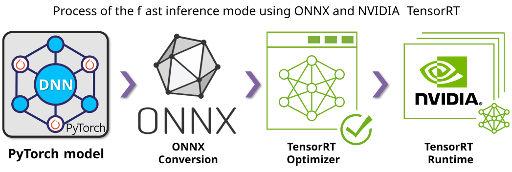

# 🛫 Jetson inference with CrackMamba

This package uses **CrackSeU + CrackMamba_G pretrained on Deepcrack** for pavement crack segmentation. It provides a matching model, a selected checkpoint, prepared image patches, PyTorch inference, a portable ONNX export, numerical validation, and a TensorRT 10 runner. The deployment model differs from the Steelcrack G+L training example in the repository root.

The field experiment is described in Section 5 and Figs. 14–16 of [our paper](https://doi.org/10.1016/j.eswa.2026.133035). The paper applies the Deepcrack model to pavement images without fine-tuning.

> **Verification scope:** The portable ONNX exporter expresses the selective-scan recurrence with standard ONNX `Loop` nodes. This preserves input-dependent state updates rather than freezing the scan output during tracing. This path is intended for correctness checks; it does not reproduce the original optimized CUDA scan kernel. TensorRT parsing, numerical equivalence, and speed must be checked on the target Orin before using the resulting engine. The paper's throughput figures are not measurements of this portable export.

The checkpoint loads all 237 state-dictionary entries strictly. Local CPU validation passed on all three published patches with PyTorch 2.6.0, ONNX Runtime 1.20.1, and NumPy 1.26.4: maximum probability error `1.54e-5`, mean absolute error at most `7.41e-8`, and zero thresholded-mask disagreement. The [recorded validation report](validation/cpu_reference.json) includes all eight input-dependent recurrent scans. Eighteen automated tests cover scan geometry, recurrence, preprocessing, output files, runtime ordering, and validation failures. GPU/Mamba and TensorRT checks remain target-device work.

[Environment](#-1-environment) · [Files](#-2-files-and-model) · [Workflow](#-3-workflow) · [Outputs](#-4-outputs-and-timing) · [Performance](#-5-paper-reported-performance)

## 🔧 1. Environment

Keep the Jetson inference environment separate from the older desktop training environment. The paper reports:

| Component | Paper configuration |
| --- | --- |
| Device | NVIDIA Jetson AGX Orin, 32 GB LPDDR5 |
| JetPack / Jetson Linux | 6.2 / 36.4.3 |
| Ubuntu | 22.04 |
| CUDA | 12.6.68, as reported in the paper |
| cuDNN / TensorRT | 9.3.0 / 10.3.0 |
| Python / PyTorch | 3.10.16 / 2.6.0 |
| Mamba | 2.2.4 |

Follow [JetPack 6.2](https://docs.nvidia.com/jetson/jetpack/6.2/release-notes/index.html) for the system compute stack and [NVIDIA's PyTorch for Jetson guide](https://docs.nvidia.com/deeplearning/frameworks/install-pytorch-jetson-platform/index.html) for a CUDA-enabled ARM64 PyTorch build matched to your JetPack and Python versions. NVIDIA lists CUDA 12.6.10 in the JetPack release notes; retain the paper's version label above and record the actual installed versions when reproducing the experiment.

From the **repository root**, install the deployment dependencies after installing PyTorch:

```bash
python -m pip install -r deploy/jetson/requirements.txt
mkdir -p deploy/jetson/artifacts
python deploy/jetson/check_environment.py \
  --output deploy/jetson/artifacts/environment.json
```

On Orin, add `--require-cuda --require-tensorrt` to the environment check to fail if CUDA-enabled PyTorch or TensorRT 10 is unavailable. Without these flags, the command records available and missing components for diagnostics.

The system TensorRT Python bindings must be visible in the active Python environment. If using a virtual environment, create it with access to the JetPack system packages or install bindings that match the system TensorRT libraries. Install the matching `mamba-ssm` CUDA extension only when using the optimized PyTorch backend; the reference backend and ONNX validation do not require Mamba.

The TensorRT runner also requires [PyCUDA](https://documen.tician.de/pycuda/install.html), built against the target device's CUDA toolkit. With the toolkit and build tools available on Orin, install it into the same Python environment:

```bash
python -m pip install pycuda
python -c "import tensorrt, pycuda.driver; print('TensorRT:', tensorrt.__version__)"
```

For the optimized PyTorch path, use the selective-scan extension from [Mamba 2.2.4](https://github.com/state-spaces/mamba/tree/v2.2.4), matching the paper. Its build must match your ARM64 PyTorch and CUDA environment. The requirements file intentionally leaves the system compute stack and these device-specific extensions to the target environment.

On Orin, also record the device power configuration with `sudo nvpmodel -q`. Power-mode IDs depend on the module and configuration; use the modes supported by your device.

## 🧩 2. Files and model

```text
deploy/jetson/
├── checkpoints/crackmamba_global_deepcrack_epoch15.pth
├── models/
│   ├── crackseu_global.py       # G-only network and strict checkpoint loading
│   ├── global_scan.py          # Spatial scan layout and scan projections
│   ├── selective_scan.py       # Reference recurrence and explicit export bridge
│   └── onnx_scan.py            # Lower the scan into standard ONNX Loops
├── preprocess.py               # Shared RGB preprocessing and output saving
├── infer_pytorch.py            # PyTorch reference or optimized CUDA inference
├── export_onnx.py              # Portable ONNX export
├── validate_export.py          # Numerical and scan-dependency checks
├── build_engine.sh             # Validated ONNX to a local TensorRT engine
├── infer_tensorrt.py            # TensorRT inference and prediction saving
├── trt_runtime.py              # Named I/O, CUDA buffers, and synchronization
├── check_environment.py
├── requirements.txt
└── samples/                    # Three prepared pavement patches
```

The bundled checkpoint is the selected **Deepcrack, G-only, epoch 15** checkpoint. Its original training batch-size label is 12; deployment uses **batch size 1**. Checkpoint loading is strict so a Steelcrack G+L checkpoint cannot silently load into this model.

```text
Checkpoint: deploy/jetson/checkpoints/crackmamba_global_deepcrack_epoch15.pth
SHA256:     24c12cc000cce3a62c8027bb91ede3b97ba1b1362f432fe5bfbbc0283e6b9220
```

The example starts from prepared **480 × 480 RGB patches**. The same preprocessing is used for all backends:

```text
RGB [H, W, 3] → float32 / 255 → (x - 0.5) / 0.5
             → contiguous NCHW [1, 3, H, W]
```

This release's export and validation use a fixed 480 × 480 input and reject other export dimensions. The inference commands reject mismatched image sizes; add `--resize` only when you intend to resize each image with bilinear interpolation. The model already returns a sigmoid probability map named `probability`; do not apply another sigmoid. The examples save binary masks using `probability >= 0.5`.

The three [sample images](samples/README.md) demonstrate inference and conversion. They have no ground-truth masks and are not a segmentation benchmark. The paper's camera acquisition and full-image tiling pipeline are outside this example.

## ⚡ 3. Workflow



```text
Deepcrack checkpoint + G-only model
    → PyTorch predictions
    → ONNX export
    → compare PyTorch and ONNX outputs
    → build a TensorRT engine on Orin
    → compare TensorRT outputs
    → TensorRT inference and saved predictions
```

| Stage | Entry point | Produced files |
| --- | --- | --- |
| Environment record | `check_environment.py` | Environment JSON |
| PyTorch reference | `infer_pytorch.py` | Probability maps, masks, timing JSON |
| Export | `export_onnx.py` | ONNX graph with embedded checkpoint/export metadata |
| ONNX validation | `validate_export.py` | Numerical validation JSON |
| Engine build | `build_engine.sh` | TensorRT engine, build log, and provenance JSON |
| Engine validation | `validate_export.py --engine ...` | Numerical validation JSON including TensorRT |
| TensorRT inference | `infer_tensorrt.py` | Probability maps, masks, timing JSON |

All commands below run from the repository root.

### 🐍 Step 1 — Establish the PyTorch reference

```bash
CHECKPOINT=deploy/jetson/checkpoints/crackmamba_global_deepcrack_epoch15.pth

python deploy/jetson/infer_pytorch.py \
  --checkpoint "$CHECKPOINT" \
  --images deploy/jetson/samples \
  --output-dir deploy/jetson/artifacts/pytorch \
  --device cpu --scan-backend reference \
  --warmup 1 --threshold 0.5 \
  --report deploy/jetson/artifacts/pytorch.json
```

The reference recurrence works without a Mamba CUDA extension and is slower than the optimized backend. For native PyTorch inference on Orin with the matching Mamba extension installed, use `--device cuda --scan-backend mamba`. Run the ONNX validation step with the same backend settings to check optimized PyTorch output against the exported recurrence before using its timing as a baseline.

### 📦 Step 2 — Export a fixed-shape ONNX model

```bash
python deploy/jetson/export_onnx.py \
  --checkpoint "$CHECKPOINT" \
  --output deploy/jetson/artifacts/crackmamba_global_480.onnx \
  --height 480 --width 480 --device cpu
```

The export uses batch size 1, a single main segmentation output, and the reference state update. The eight global-scan cores remain represented by input-dependent recurrent computations. No historical `.onnx` or `.trt` file is needed.

Export and engine construction refuse to overwrite existing artifacts. Choose a fresh output filename when re-exporting or changing the engine configuration.

### 🔍 Step 3 — Validate ONNX against PyTorch

```bash
python deploy/jetson/validate_export.py \
  --checkpoint "$CHECKPOINT" \
  --onnx deploy/jetson/artifacts/crackmamba_global_480.onnx \
  --images deploy/jetson/samples \
  --device cpu --scan-backend reference \
  --max-samples 3 \
  --report deploy/jetson/artifacts/onnx_validation.json
```

This stage must pass before building an engine. It checks graph structure and compares probability maps on identical preprocessed inputs with ONNX Runtime's CPU provider. Default acceptance criteria are `atol=1e-4`, `rtol=1e-3`, and binary-mask disagreement at most `1e-3` of pixels. Non-finite outputs fail validation. Retain the report with the exported graph. For a release or field deployment, use a larger representative image directory and increase `--max-samples` beyond its default of 3. Any changed tolerance should be justified and retained in the report.

### 🏗️ Step 4 — Build the engine on the target Orin

Start with FP32 to isolate export and parser issues:

```bash
bash deploy/jetson/build_engine.sh \
  --checkpoint "$CHECKPOINT" \
  --onnx deploy/jetson/artifacts/crackmamba_global_480.onnx \
  --validation-report deploy/jetson/artifacts/onnx_validation.json \
  --engine deploy/jetson/artifacts/crackmamba_global_480_fp32.plan
```

Once FP32 passes TensorRT numerical validation, build an FP16-enabled engine by adding `--fp16` and choosing a separate engine filename. TF32 is disabled by the builder to keep the FP32 comparison explicit. FP16 optimization does not imply FP16 external input/output buffers; the runner queries the engine's actual tensor data types.

Build locally for the target TensorRT and hardware environment. See [NVIDIA's engine compatibility guidance](https://docs.nvidia.com/deeplearning/tensorrt/latest/inference-library/engine-compatibility.html). Standard ONNX `Loop` import and execution must be verified with the TensorRT parser on your device. A parser failure should be fixed before proceeding; bypassing the selective scan changes the model.

### ✅ Step 5 — Validate the TensorRT engine

```bash
python deploy/jetson/validate_export.py \
  --checkpoint "$CHECKPOINT" \
  --onnx deploy/jetson/artifacts/crackmamba_global_480.onnx \
  --engine deploy/jetson/artifacts/crackmamba_global_480_fp32.plan \
  --images deploy/jetson/samples \
  --device cpu --scan-backend reference \
  --max-samples 3 \
  --report deploy/jetson/artifacts/tensorrt_validation.json
```

Repeat validation for every engine precision/configuration you intend to use. Record and inspect probability error, finite values, and binary-mask agreement. A successful export or engine build alone does not establish numerical equivalence.

### 🚀 Step 6 — Run TensorRT inference

```bash
python deploy/jetson/infer_tensorrt.py \
  --engine deploy/jetson/artifacts/crackmamba_global_480_fp32.plan \
  --images deploy/jetson/samples \
  --output-dir deploy/jetson/artifacts/tensorrt \
  --warmup 100 --threshold 0.5 \
  --report deploy/jetson/artifacts/tensorrt.json
```

Replace `--images` with your prepared patch directory. The runner uses TensorRT 10 named tensors, binds device addresses, and orders input transfer, execution, and output transfer on the same CUDA stream. It synchronizes before reading predictions on the host.

## 📁 4. Outputs and timing

For an input named `sample_01.png`, the inference commands above save:

| Output | Meaning |
| --- | --- |
| `sample_01.png.probability.npy` | Float32 probability array, shape `[H, W]` |
| `sample_01.png.probability.png` | 8-bit probability preview |
| `sample_01.png.binary.png` | Binary mask produced by `--threshold 0.5` |

Relative input paths and full filenames are retained to avoid collisions. Omit `--threshold` if you only need probability outputs. The JSON reports record the backend, input configuration, image count, warm-up, timing scope, and relevant artifact hashes. Retain the environment record, export metadata, numerical validation reports, build log, and build provenance with each deployed engine.

The runners time each input transfer, model execution, and output transfer with synchronization. Image decoding, preprocessing, postprocessing, and file saving are excluded; the TensorRT path also includes the required pinned-buffer and returned-array copies. This is a transfer-and-inference measurement, not a kernel-only or full-application benchmark.

Benchmark conditions should include the device, power mode, clock configuration, input size, batch size, precision, warm-up count, sample count, and timing scope. Three samples are useful for smoke checks but are too few for a stable performance claim.

Generated ONNX graphs, TensorRT engines, logs, and prediction folders stay in `artifacts/` and are not committed. Training launchers, compile experiments, ERF analysis, historical ONNX Runtime trials, caches, full datasets, and old prediction folders are not part of this deployment workflow.

Run the CPU regression tests from the repository root:

```bash
python -m unittest discover -s deploy/jetson/tests -v
```

## 📊 5. Paper-reported performance

| Inference mode | Power setting | Mean FPS in the paper |
| --- | --- | ---: |
| Native PyTorch | 30 W | 4.5 |
| Native PyTorch | 50 W | 8.3 |
| ONNX + TensorRT | 30 W | 17.4 |

These values describe the paper's deployment experiment. This release's portable ONNX recurrence is a separate conversion implementation and has no claimed speed equivalence to that experiment. Publish new Orin measurements with their numerical validation and timing configuration.
